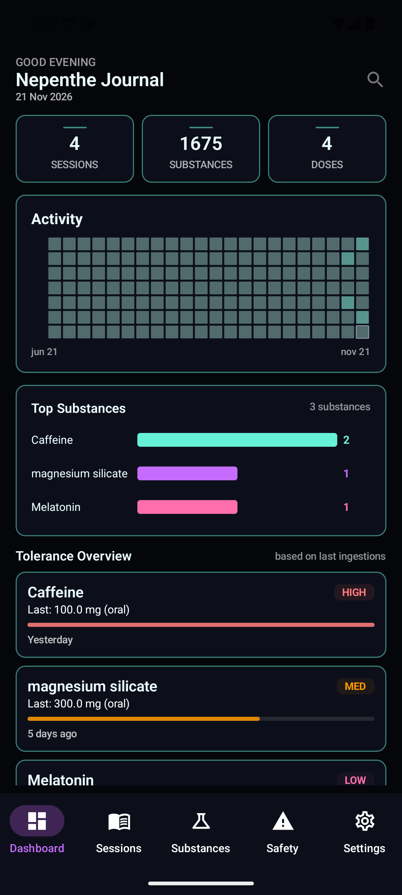
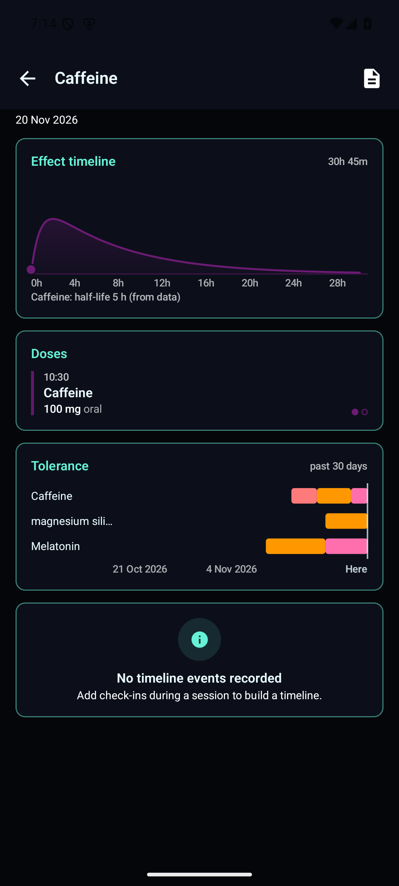
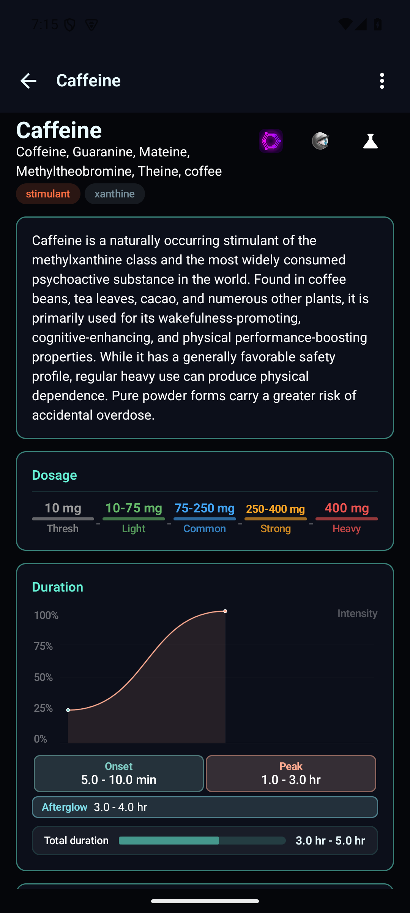
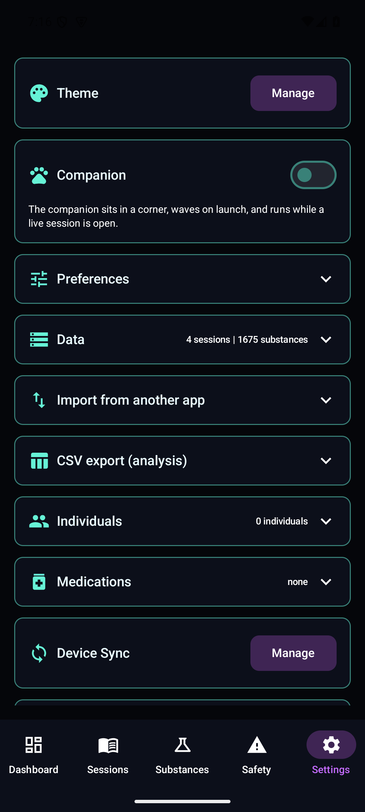

# Nepenthe Journal

A private, offline-first journal for psychoactive substance sessions, with a built-in substance reference and direct sync between your own devices.

No cloud, no accounts, no surveillance. Your data stays on your devices.

---

## Screenshots

| Dashboard | Session detail |
|:-:|:-:|
|  |  |
| **Substance reference** | **Device sync** |
|  |  |

---

## Why Nepenthe

A journal should not need an account or a server. Nepenthe keeps the journal on your device, works offline, and syncs only with devices you pair on your own network.

It brings session logging, dose tracking, tolerance, effect timelines, and a substance reference into one app.

---

## Install

Download the latest build for Windows, macOS, Linux, or Android from [Releases](https://github.com/Wolren/NepentheJournal/releases). The iOS app builds from the included Xcode project.

---

## Features

- Session log with substances, doses, routes, check-ins, and timeline events
- 1,675-substance offline reference with dosage by route, duration, effects, interactions, and pharmacology
- Tolerance overview, activity heatmap, effect timeline, and dose-duration curves
- Interaction checks, including standing medications
- Free-form Markdown notes and trip-report export
- Direct LAN sync between paired devices; no cloud relay
- Sealed backups, JSON/CSV export, and imports from other journals
- Themes with custom colors, card styles, backgrounds, and opacity
- Full-text search across sessions, substances, doses, notes, and effects
- Android quick-log links for shortcuts and automation

---

## Using the app

- **Dashboard:** greeting, stats, activity heatmap, sessions trend, and tolerance overview
- **Sessions:** search, filters, favorites, calendar, and full session editors
- **Substances:** search, category chips, dosage and duration detail, curves, pharmacology, and custom substances
- **Safety:** harm reduction guidance and external resources
- **Settings:** theme, sync, data import and export, backups, and the substance library

Editors, detail views, and the calendar open as full-screen overlays over the current tab.

---

## Sync between your devices

One device hosts, and your other devices connect over the local network. Changes move both ways, deletes propagate, and conflicting edits to the same note appear as a pending conflict instead of silently overwriting.

Requests are authenticated, so only paired devices can write into your journal. No cloud relay is involved.

---

## Your data

The journal, its backups, and its temp file are sealed at rest with AES-256-GCM under a device-held key. **Seal backup** in Settings > Data writes a passphrase-protected `.nepbak` you can store anywhere; **Restore sealed** brings it back.

JSON and CSV exports stay plaintext so other tools can read them. Android accepts `nepenthe://quicklog` links, so a shortcut or another app can log a dose.

---

## Themes

- Six presets: Forest, Ocean, Sunset, Ember, Midnight, Mono
- Custom colors, card styles, background images, and opacity
- Text contrast adjusts automatically for readability
- The theme is stored with the journal and restored on launch

---

## Reference data

The app ships a merged reference catalog of 1,675 substances. It combines DoseWiki's dosage, duration, effect, interaction, and pharmacology records with public PsychonautWiki-derived data and medicine identifiers. The catalog is bundled; no reference API is called at runtime. The optional FDA drug-label card is the only feature that uses the network.

Substance prose and data licenses are listed in the [NOTICE](NOTICE) and the acknowledgments below.

---

## Platform support

| Target | Minimum | Notes |
|---|---|---|
| Windows | 10 (1809) or later, x64 | MSI and portable zip, per-user |
| Windows on ARM | 11 | Runs the x64 build under emulation |
| macOS | 11 or later on Apple Silicon | Signed and notarized DMG; an Intel DMG ships for x64 Macs |
| Linux | x64 desktop with GTK 3 | DEB package; X11 or Wayland through XWayland |
| Android | 8.0 (API 26) | ARM builds |
| iOS | 16.0 | iPhone and iPad |

Android and iOS keep the journal inside the app sandbox. Use LAN sync or the JSON and CSV exports to move data between devices.

---

## Development

Build instructions, the tech stack, CI and release workflows, and the reference catalog pipeline live in [docs/DEVELOPMENT.md](docs/DEVELOPMENT.md).

---

## Contributing

Contributions are welcome. Read [CONTRIBUTING.md](CONTRIBUTING.md) before opening a pull request.

---

## Privacy

Nepenthe Journal does not collect, transmit, or sell personal information. No accounts, no analytics, no telemetry, no servers. Read the full [privacy policy](https://wolren.github.io/NepentheJournal/privacy.html).

---

## License

Code: GNU General Public License v3.0. See [LICENSE](LICENSE).

Bundled reference data has its own terms (see [NOTICE](NOTICE)): DoseWiki substance prose is [CC0 1.0](https://dose.wiki/docs/license); TripSit interaction risk and dose data retain TripSit's non-commercial attribution; PsychonautWiki-derived seed data is sourced from the public Semantic MediaWiki API and used under fair use / public data principles, with attribution below.

## Acknowledgments

- **DoseWiki** ([dose.wiki](https://dose.wiki/)): the primary reference source for dosage, duration, interactions, pharmacology, and subjective effects, released as CC0 open data.
- **PsychonautWiki Journal** by Isaak Hanimann ([GitHub](https://github.com/isaakhanimann/psychonautwiki-journal-android)): this project's feature reference and conceptual predecessor, licensed under GPL-3.0-or-later. Nepenthe Journal is a derivative work with a redesigned architecture and new features.
- **PsychonautWiki** ([psychonautwiki.org](https://psychonautwiki.org)): public substance reference data accessed via their Semantic MediaWiki API and bundled as seed data.
- **TripSit** ([tripsit.me](https://tripsit.me)): combination interaction and risk-assessment data, plus dose ladders for compounds outside DoseWiki.
- **Wikidata** ([wikidata.org](https://www.wikidata.org)): medicine names and identifiers under CC0 1.0.
- **IUPHAR/BPS Guide to Pharmacology**: ligand-target interaction data.
- **PDSP Ki Database** (NIMH Psychoactive Drug Screening Program): Ki binding data.
- **BindingDB**: public affinity measurements.
